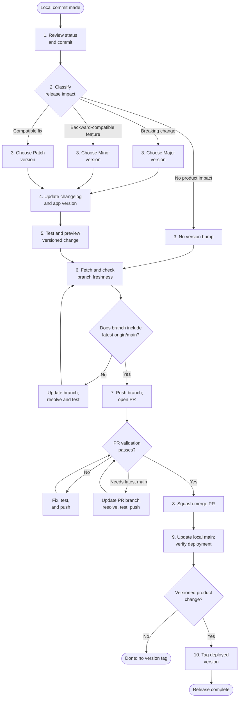

# Releasing flow

This is the primary guide for taking a local commit through review and
deployment. Start at the flowchart, then use the linked procedure references
immediately below it to jump to the detailed steps.

Each PR that changes the product must include its SemVer version and changelog
entry before it merges to `main`; merging then deploys that version to GitHub
Pages. Documentation-only and internal-only changes with no product impact do
not need a version bump. Dependabot dependency updates remain excluded from
product versioning. Version tags are created after a versioned PR deploys and
is verified; a tag by itself does not deploy the site.

## Flowchart



### Flowchart action links

- **1. Inspect status and review commit:** [After a local commit](#after-a-local-commit)
- **2. What is the release impact?:** [Classify release impact](#classify-release-impact)
- **3. Choose the SemVer version and include it in the change PR:**
  [Prepare version and changelog](#prepare-version-and-changelog)
- **4. Update the changelog and app version:** [Prepare version and changelog](#prepare-version-and-changelog)
- **5. Test and preview the versioned change:** [Prepare version and changelog](#prepare-version-and-changelog)
- **6. Fetch GitHub and check branch freshness:** [Refresh and verify `main`](#refresh-and-verify-main)
- **6a. Before opening a PR, merge `origin/main`; resolve and test:**
  [Update a branch that is behind `main`](#update-a-branch-that-is-behind-main)
- **6b. For an existing PR that needs recent `main`, update its branch and
  revalidate:** [Update a branch that is behind `main`](#update-a-branch-that-is-behind-main)
- **7. Push branch and open pull request:** [Open and validate a change PR](#open-and-validate-a-change-pr)
- **8. Squash-merge the PR:** [Open and validate a change PR](#open-and-validate-a-change-pr)
- **9. Update local `main` and verify deployment:** [Merge and clean up a change PR](#merge-and-clean-up-a-change-pr)
- **10. Tag the deployed version:** [Tag and verify the release](#tag-and-verify-the-release)

For work that must be preserved while updating a branch but cannot yet be
committed, use the [local-update exception](./LOCAL-REPO-UPDATE.md) instead of
the normal branch-update steps.

## Releasing with Copilot

For a request such as “release the latest commit on this branch,” Copilot
follows this confirmation-gated procedure:

1. Check the branch and worktree, fetch `origin`, and inspect the commits and
   product diff since `origin/main`. Stop if unrelated or uncommitted changes
   make the release scope unclear, or if the branch needs updating.
2. Recommend `major`, `minor`, `patch`, or `none` using the
   [impact categories](#classify-release-impact), with a brief explanation
   based on the changes. Dependabot dependency updates remain excluded.
3. Propose the exact changelog notes and version. Review `README.md` and the
   in-app User Guide at `src/components/tabs/UserGuideTab.tsx`; propose edits
   only when the change makes either inaccurate or incomplete. Explicitly
   report when no README or User Guide edit is needed.
4. Ask for confirmation of the impact and proposed documentation before
   editing any release files. After approval, apply only the approved changes
   and follow [Prepare version and changelog](#prepare-version-and-changelog).
5. Run checks and show the final diff. Ask before pushing the branch or
   creating/updating its PR. After PR validation passes, ask again before
   merging; a merge to `main` triggers the existing deployment. Verify the
   deployed version and behavior, then ask before pushing a version tag.

For `none`, do not bump the app version or create a version tag. A merge to
`main` may still run the existing Pages workflow. The assistant does not push
directly to protected `main`, merge without confirmation, or infer a release
impact without presenting its rationale.

## After a local commit

Run these commands in PowerShell from the repository:

```powershell
git status --short --branch
git show --stat --oneline HEAD
git diff
```

Confirm you are on the intended feature or maintenance branch. A
local commit does not push anything to GitHub. If the working tree is not
clean, inspect the remaining changes: they are not included in the commit.
Commit another checkpoint if those changes belong in the same work, or keep
them separate and do not switch branches with them.

If work was committed accidentally on local `main`, create a branch before
pushing. The commit will be carried onto the new branch:

```powershell
git switch -c maintenance/short-description
git status --short --branch
```

Do not push directly to protected `main`.

**Next:** Continue to [Classify release impact](#classify-release-impact)
([flowchart step 2](#flowchart)).

## Classify release impact

Classify the change by its effect on the product, not just its commit message
or branch name. If a PR contains several product changes, use the highest
applicable impact among them.

| Impact | Use when | Version change |
| --- | --- | --- |
| Major | A breaking product change requires users to change how they use or integrate the app. | Increase the major version; reset minor and patch to zero. |
| Minor | A backward-compatible user-facing capability is added. | Increase the minor version; reset patch to zero. |
| Patch | A compatible bug fix or other small product correction is made. | Increase the patch version. |
| No release | The change does not alter the released product, such as documentation-only or internal-only work. | No version bump or release tag for this change. |

Dependency changes are not automatically “no release”: classify them by their
actual product impact. The exception is routine
[Dependabot dependency-update PRs](#dependency-update-prs), which do not
themselves create a product release or version tag.

All changes still go through a PR to `main`. Every product-impacting change
must include its version and changelog entry in that same PR, so no product
change can deploy ahead of its version. Do not defer its version bump or
combine it with product changes in later PRs. The narrow catch-up exception
for already-deployed code without a version bump is detailed under
[Prepare version and changelog](#prepare-version-and-changelog).

**Next:** For a product-impacting change, continue to
[Prepare version and changelog](#prepare-version-and-changelog). For a
no-release change, continue to [Refresh and verify `main`](#refresh-and-verify-main).

## Protecting `main`

Import [`.github/rulesets/protect-main.json`](../.github/rulesets/protect-main.json)
from **Settings → Rules → Rulesets → New branch ruleset → Import a ruleset**.
The ruleset requires changes to `main` to arrive through pull requests, allows
squash merges without requiring an approval, and blocks force-pushes and branch
deletion. It requires the **Validate pull request** status check, which checks
release metadata, runs the tests, and builds the production app.

This is a one-time repository setup, not a step in each release. After
configuring the ruleset, return to the point in the [flowchart](#flowchart)
where you paused.

## Refresh and verify `main`

Fetch remote changes before deciding whether the working branch is current:

```powershell
git fetch origin
git merge-base --is-ancestor origin/main HEAD
```

If `git merge-base` exits with code `0`, the branch includes the latest fetched
`origin/main`. If it exits with code `1`, the branch does not include that
commit; follow [Update a branch that is behind `main`](#update-a-branch-that-is-behind-main),
then return here and run the freshness check again.
For any other error, stop and resolve the Git or remote-reference problem
before proceeding.

This is the PR-readiness check: it tests whether the current branch contains
the latest `origin/main` now. Recheck after fetching if `main` may have moved
again before merge.

**Next:** When the check exits with code `0`, continue to
[Open and validate a change PR](#open-and-validate-a-change-pr)
([flowchart step 7](#flowchart)). If it exits with code `1`, follow the
update-and-return path above. Stop on any other error.

## Start a change

For new work, start with a clean working tree and an up-to-date local `main`.
Check the state before switching:

```powershell
git status --short --branch
```

If there are uncommitted changes on a feature branch, finish a local commit
before switching. Do not switch with changes you do not intend to carry over.
Update local `main` and create a descriptive branch:

```powershell
git fetch origin
git switch main
git pull --ff-only origin main
git status --short --branch
git switch -c maintenance/short-description
git status --short --branch
```

Use a prefix such as `feature/`, `fix/`, or `maintenance/` as appropriate.
Confirm the branch name and clean working tree before starting. If
`git pull --ff-only` fails, stop and resolve the branch history rather than
forcing the update.

If work was accidentally started on local `main` with uncommitted changes,
create the new branch directly without stashing; `git switch -c` carries
staged, unstaged, and untracked changes to it. Check the branch and status
afterward.

**Next:** Work on the new branch, then use
[Review and commit checkpoints](#review-and-commit-checkpoints). After each
commit, return to [After a local commit](#after-a-local-commit).

## Review and commit checkpoints

Before each commit, review the staged and unstaged changes:

```powershell
git status --short --branch
git diff --cached --check
git diff --cached
git diff
```

Stage only the files for the phase you are ready to checkpoint. For example:

```powershell
git add -- src\example.ts
```

Use `git add -A` only when every changed, deleted, and untracked file belongs
in this commit. Review the staged diff, then commit:

```powershell
git diff --cached --check
git diff --cached
git commit -m "Describe this phase"
git status --short --branch
```

In VS Code, **Commit** also makes a local commit. Push is separate. If the
tree is clean after the commit, you can start another phase on the same
branch. Each commit on that branch will be part of its pull request.

**Next:** Return to [After a local commit](#after-a-local-commit)
([flowchart step 1](#flowchart)) to review the checkpoint and continue.

## Update a branch that is behind `main`

First commit or otherwise save work so the tree is clean. Then fetch and merge
the latest `main` into the feature or maintenance branch:

```powershell
git status --short --branch
git fetch origin
git switch maintenance/short-description
git merge origin/main
```

Resolve conflicts, run relevant checks, and push the updated branch. Do not
reset or force-push to get past conflicts. If `main` advances again before the
PR merges, repeat the freshness check and update.

**Next depends on why you came here:**

- From [Refresh and verify `main`](#refresh-and-verify-main) before opening a
  PR: finish checks and push the branch, then return there and rerun the
  freshness check. When it passes, continue to
  [Open and validate a change PR](#open-and-validate-a-change-pr).
- From PR validation because an existing PR needs recent `main`: push the
  updated branch to that PR, then return to
  [Open and validate a change PR](#open-and-validate-a-change-pr) to check
  validation again. Do not create a second PR.
If you cannot checkpoint your current work first, follow the
[local-update exception](./LOCAL-REPO-UPDATE.md). It stashes staged,
unstaged, and untracked changes, merges `origin/main`, and restores the work
without discarding the backup. After restoring and verifying your work, finish
the applicable checks and push described above, then follow the same
caller-specific return path.

## Open and validate a change PR

Push the branch and open a PR targeting `main`:

```powershell
git push -u origin maintenance/short-description
gh pr create --base main --head maintenance/short-description --title "Describe the change"
```

For later pushes to the same branch, `git push` is sufficient. Alternatively,
open the PR on GitHub. Confirm it targets `main`; wait for **Validate pull
request** to pass, then choose **Squash and merge**. Do not push directly to
`main`. Avoid VS Code's **Commit & Push** or **Commit & Sync** actions while
`main` is checked out.

If validation requires the branch to include recent `main` changes, first
commit or otherwise save your work so the tree is clean, then follow
[Update a branch that is behind `main`](#update-a-branch-that-is-behind-main),
then push the updated branch to the existing PR and check validation again.

After resolving conflicts, rerun checks and push again.

For product-impacting changes, include the version bump, updated
`package-lock.json`, and matching `CHANGELOG.md` release entry in this PR.
For changes to app source, public data/assets, build configuration, or
production dependencies, include exactly one of these lines in the PR
description: `Release-impact: major`, `Release-impact: minor`,
`Release-impact: patch`, or `Release-impact: none`. The **Validate pull
request** check requires the selected impact to match the SemVer increase,
and verifies the lockfile and changelog entries. It excludes documentation,
test/fixture files, and development-only dependencies. Use `none` only for an
app-path change that has no product impact, such as an internal-only refactor;
the check then allows the app version to remain unchanged. Dependabot PRs are
exempt from the version check.

**Next:** When validation passes, squash-merge the PR, then continue to
[Merge and clean up a change PR](#merge-and-clean-up-a-change-pr)
([flowchart step 8](#flowchart)). If validation fails for another reason, fix
the issue, push, and check validation again. If it needs recent `main`, follow
the update-and-return path above.

## Merge and clean up a change PR

After GitHub confirms the squash-merge, update local `main` before starting
another change:

```powershell
git status --short --branch
git switch main
git pull --ff-only origin main
git status --short --branch
```

Switch only when the working tree is clean. Confirm `main` tracks
`origin/main` and is up to date.

**Next:** Continue to [After a change PR is merged](#after-a-change-pr-is-merged)
([flowchart step 9](#flowchart)) to verify the deployment and, if versioned,
tag the release.

## After a change PR is merged

The change is now on `main`; a push to `main` automatically runs the deploy
workflow when checks pass. Confirm the deployment completed and the production
site reflects the merged change. For a product-impacting change, verify the
live footer and About tab show the version included in this PR. If the normal
workflow did not start, use [Manual deployment fallback](#manual-deployment-fallback),
then return here.

After verifying the merge, you may delete the old local feature branch:

```powershell
git branch -d maintenance/short-description
```

GitHub may delete the remote branch automatically. Start the next change with
a new feature or maintenance branch.

**Next:** For a versioned product change, continue to
[Tag and verify the release](#tag-and-verify-the-release)
([flowchart step 10](#flowchart)). For a no-release change or a Dependabot
update, no version tag is needed; continue to [Start a change](#start-a-change)
when ready.

## Dependency update PRs

The [Dependabot configuration](../.github/dependabot.yml) checks npm
dependencies weekly and groups patch/minor updates. `package.json` declares
direct dependency ranges; `package-lock.json` records the exact resolved
dependency tree installed by `npm ci`. Dependabot updates these files in its
PRs. The configuration controls the schedule and grouping, not the lockfile.

Every PR runs the **Pull request validation and Dependabot updates** workflow.
It checks the release version (exempting Dependabot), installs from the
lockfile, runs the complete test suite, and builds the production app. After
validation, identified patch and minor updates are squash-merged
automatically; major updates and updates whose version type cannot be
identified remain for manual review. A successful merge to `main` triggers
GitHub Pages deployment explicitly, because merges performed with
`GITHUB_TOKEN` do not trigger the normal `push` deployment event. These
dependency updates are the explicit exception to the same-PR version rule:
they do not change the app version, create a product release, or need a
version tag.

**Next:** For an auto-merged update, no release-tag step is needed; when
starting new work, use [Start a change](#start-a-change) to refresh local
`main`. For an update left for manual review, finish reviewing and merging
that PR through GitHub, then use
[Merge and clean up a change PR](#merge-and-clean-up-a-change-pr) to update
local `main` and [After a change PR is merged](#after-a-change-pr-is-merged)
to continue. Do not cut a product release solely for a dependency update.

## Prepare version and changelog

For a product-impacting PR, choose the SemVer increase using the
[impact categories above](#classify-release-impact):

- **Major** for breaking changes.
- **Minor** for backward-compatible user-facing features.
- **Patch** for compatible fixes.
- **No release** for changes with no product impact, such as documentation-only
  or internal-only work.

When a PR contains changes of multiple types, use the highest impact.
Ordinarily, each product-impacting PR gets its own version increase; do not
defer it to a later PR that only changes release metadata or combine it with
changes that have already deployed. The sole catch-up exception is for product
code already present in a successful Pages deployment without its version
bump. Confirm the deployed commit and require the base branch's `[Unreleased]`
notes to describe that deployed change. Choose the next exact `X.Y.Z` version
after the current app version on `main`.
Include the matching line in the PR description, for example
`Release-impact: patch`. The PR check enforces the declared increase:
major advances `X` and resets `Y` and `Z`, minor advances `Y` and resets `Z`,
and patch advances `Z`.

Update `CHANGELOG.md`: keep a fresh, empty `[Unreleased]` section at the top
and move the completed product changes below it into a new
`## [X.Y.Z] - YYYY-MM-DD` section. Use the same version as the app.

After the approved release notes are under `[Unreleased]`, run the release
dry run first:

```powershell
npm run release:prepare -- --base origin/main --impact patch --dry-run
```

Replace `patch` with the confirmed `major` or `minor` impact. The dry run
calculates the candidate `X.Y.Z` version from `origin/main`, prints the exact
release-metadata diff, then applies that candidate only in an isolated
temporary copy of the current worktree. It runs release-tooling tests, the
complete app test suite, and the production build against the candidate
package versions. If dependencies changed, it installs them from the candidate
lockfile in the temporary copy. It removes the temporary copy afterward and
does not change the worktree or interact with GitHub. It refuses to run on
`main`, against a stale/already-versioned package, without detected product
changes unless `--catch-up` is used, or without release notes. Catch-up also
requires the base `[Unreleased]` notes to be carried into the versioned entry.
If any check fails, fix the issue and repeat the dry run before preparing the
release.

After reviewing a successful dry-run diff and results, prepare the matching
app and changelog versions with the same command without `--dry-run`:

```powershell
npm run release:prepare -- --base origin/main --impact patch
```

`--date YYYY-MM-DD` can set a specific changelog date. The command does not
stage, commit, push, create a PR, merge, deploy, or tag. The preview does not
simulate GitHub Actions or the live Pages environment; PR validation and
post-deployment verification remain separate gates.

For an approved catch-up, the product files must already be present in the
base branch; the PR changes release metadata only. Use the same preparation
flow with `--catch-up`, after confirming the base `[Unreleased]` notes:

```powershell
npm run release:prepare -- --base origin/main --impact minor --catch-up --dry-run
npm run release:prepare -- --base origin/main --impact minor --catch-up
```

The catch-up option refuses product-file changes in the PR and requires the
base branch's existing `[Unreleased]` notes to appear in the new version
section. Include exactly one `Release-impact: major`, `Release-impact: minor`,
or `Release-impact: patch` line matching the approved impact and exactly one
`Release-catch-up: true` line in the PR description. The local release check
can validate the same decision with:

```powershell
npm run release:check -- --base origin/main --impact minor --catch-up
```

Vite reads the version from `package.json` and injects it into the page footer
and About-tab heading. Include the changelog, package files, and product
changes in the same PR. For no-impact work, run the read-only dry run with
`--impact none` to test the current worktree without changing release metadata:

```powershell
npm run release:prepare -- --base origin/main --impact none --dry-run
```

Do not run the mutating version-preparation command or create a version tag.
For UI or interaction changes, serve the built app locally with
`npm run preview -- --host 127.0.0.1` and exercise the affected flows at both
desktop and mobile viewport sizes before asking to push or open/update a PR.
Check the responsive layout and affected interactions in both sizes. Report
if browser-based inspection is not available.

Run the local version check against the same base and selected impact:

```powershell
npm run release:check -- --base origin/main --impact patch
```

Use the confirmed impact, or `none` for a no-impact change. For app source,
public assets/data, build configuration, or production dependency changes (and for
every catch-up release, even though its PR changes release metadata only),
include exactly one `Release-impact: major`, `Release-impact: minor`,
`Release-impact: patch`, or `Release-impact: none` line in the PR description.
The PR check enforces the declared version increase and verifies the changelog
and lockfile. The `none` declaration is for path-classified changes with no
product impact; documentation, test-only, and development-dependency-only
changes need no release metadata. Dependabot is exempt.

If the preparation command is unavailable, manually move the approved
`[Unreleased]` entries into a dated `## [X.Y.Z]` section, preserve a fresh
empty `[Unreleased]` section, and set `package.json`'s `version`, the
top-level `package-lock.json` `version`, and `package-lock.json`'s
`packages[""].version` to the same `X.Y.Z`. The PR validation remains the
final version/changelog check.

Run the release checks locally:

```powershell
npm ci
npm test -- --run
npm run build
```

`npm ci` checks that the lockfile can reproduce the install, and tests check
behavior. Resolve failures before continuing. The build must use the new
version so the displayed app version matches the changelog and package files.

On Windows, if `npm ci` fails with `EPERM` while unlinking a file under
`node_modules`, a running Vite server may be locking it. Stop it with
`Ctrl+C` in its terminal. If you cannot find that terminal, inspect Node
processes and identify the one whose command line points to this project:

```powershell
Get-CimInstance Win32_Process -Filter "Name = 'node.exe'" |
  Select-Object ProcessId, CommandLine
```

Stop only the matching project process IDs, including the Vite child process:

```powershell
Stop-Process -Id <PID>
```

Replace `<PID>` with each matching process ID, then retry `npm ci`. If the
error persists, another editor process or antivirus software may be holding
the file.

Preview the production build after changing the version:

```powershell
npm run preview
```

`npm run preview` serves the existing `dist/`; it does not rebuild it. Open
the printed local URL, check the footer, then open the About tab and check
that both display the expected version (for example, `v1.8.0`). Stop the
preview server with `Ctrl+C`.

**Next:** Stage and commit the changelog and version files together with the
product change through [Review and commit checkpoints](#review-and-commit-checkpoints),
then open and validate the same change PR.

## Tag and verify the release

After GitHub confirms a versioned product PR is merged, update local `main`
using [After a change PR is merged](#after-a-change-pr-is-merged). Confirm the
latest commit is the versioned PR merge:

```powershell
git log -1 --oneline
```

If the latest commit is not the versioned PR merge, stop and investigate.
Confirm the **Deploy to GitHub Pages** run for the merged commit completes
successfully. Open the production URL and verify the footer and About tab show
the expected version and the key changes are live. If deployment failed,
inspect its logs and fix the issue on a follow-up feature or maintenance
branch, then use the everyday PR workflow. Do not tag an unverified
deployment.

After verification, create and publish an annotated version tag for the exact
release revision:

```powershell
git tag -a vX.Y.Z -m "Release vX.Y.Z"
git push origin vX.Y.Z
```

Pushing the tag makes it available on GitHub but does not trigger deployment.
Do not move or overwrite a published tag.

For the first release that enables PWA support, verify the deployed app at its
GitHub Pages URL in a clean browser profile and on target browsers/platforms:

- Confirm the app manifest and icons load and the browser offers its native
  install option. The in-app install notice appears only in browsers that
  provide an install prompt; dismissing it should keep it hidden.
- Install the app, then confirm it can launch offline after its first online
  visit and cache. Reload while offline and verify game data, layout images,
  setup generation, and saved settings.
- Reconnect and confirm a subsequent app release is picked up by the service
  worker. Follow the PWA section in the User Guide for manual installation
  steps in browsers without an in-app prompt.

**Next:** After deployment and product verification pass, the release is
complete. If deployment failed, fix it through the everyday
[change PR workflow](#open-and-validate-a-change-pr), then return here to verify
the deployment; do not move or overwrite the published tag.

## Manual deployment fallback

If a push to `main` did not start the workflow, open **Actions** →
**Deploy to GitHub Pages** → **Run workflow**, select `main`, and start it.
Confirm the run finishes successfully and verify the production URL. After
verification, return to the procedure that sent you here and continue its
remaining steps: [Tag and verify the release](#tag-and-verify-the-release)
for a versioned product change, or [After a change PR is merged](#after-a-change-pr-is-merged)
for a no-release change. Use this only when the normal deployment workflow did
not start; manually running it does not replace the release tag.
