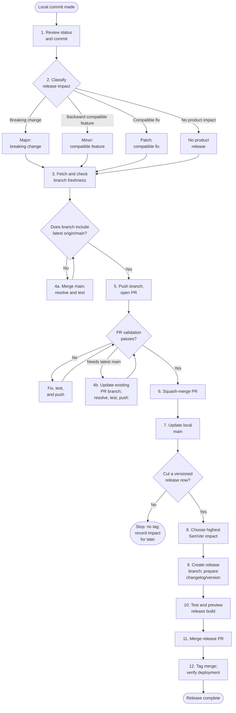

# Releasing flow

This is the primary guide for taking a local commit through review and, when
appropriate, a versioned production release. Start at the flowchart, then use
the linked procedure references immediately below it to jump to the detailed
steps.

Merging a PR to `main` automatically deploys the site if checks pass. A
versioned release is an additional process: it records a SemVer version in the
changelog and app, then creates a tag for the merged release commit. A tag by
itself does not deploy the site.

## Flowchart



### Flowchart action links

- **1. Inspect status and review commit:** [After a local commit](#after-a-local-commit)
- **2. What is the release impact?:** [Classify release impact](#classify-release-impact)
- **3. Fetch GitHub and check branch freshness:** [Refresh and verify `main`](#refresh-and-verify-main)
- **4a. Before opening a PR, merge `origin/main`; resolve and test:**
  [Update a branch that is behind `main`](#update-a-branch-that-is-behind-main)
- **4b. For an existing PR that needs recent `main`, update its branch and
  revalidate:** [Update a branch that is behind `main`](#update-a-branch-that-is-behind-main)
- **5. Push branch and open pull request:** [Open and validate a change PR](#open-and-validate-a-change-pr)
- **6. Squash-merge the PR:** [Open and validate a change PR](#open-and-validate-a-change-pr)
- **7. Update local `main`:** [Merge and clean up a change PR](#merge-and-clean-up-a-change-pr)
- **8. Choose the release impact:** [Choose the release version](#choose-the-release-version)
- **9. Create release branch and prepare changelog/version:** [Prepare a release branch](#prepare-a-release-branch)
- **10. Validate and preview the release build:** [Validate and preview the release](#validate-and-preview-the-release)
- **11. Open and merge release PR:** [Merge the release PR](#merge-the-release-pr)
- **12. Update `main`, tag, and verify:** [Tag and verify the release](#tag-and-verify-the-release)

For work that must be preserved while updating a branch but cannot yet be
committed, use the [local-update exception](./LOCAL-REPO-UPDATE.md) instead of
the normal branch-update steps.

## After a local commit

Run these commands in PowerShell from the repository:

```powershell
git status --short --branch
git show --stat --oneline HEAD
git diff
```

Confirm you are on the intended feature, maintenance, or release branch. A
local commit does not push anything to GitHub. If the working tree is not
clean, inspect the remaining changes: they are not included in the commit.
Commit another checkpoint if those changes belong in the same work, or keep
them separate and do not switch branches with them.

If work was committed accidentally on local `main`, create a branch before
pushing. The commit will be carried onto the new branch:

```powershell
git switch -c maintenance/short-description
git status --short --branch
```

Do not push directly to protected `main`.

**Next:** Continue to [Classify release impact](#classify-release-impact)
([flowchart step 2](#flowchart)).

## Classify release impact

Classify the change by its effect on the product, not just its commit message
or branch name. The classification helps choose the version when a release is
cut. If a release contains several changes since the previous release, use the
highest applicable impact among all of them.

| Impact | Use when | Version change |
| --- | --- | --- |
| Major | A breaking product change requires users to change how they use or integrate the app. | Increase the major version; reset minor and patch to zero. |
| Minor | A backward-compatible user-facing capability is added. | Increase the minor version; reset patch to zero. |
| Patch | A compatible bug fix or other small product correction is made. | Increase the patch version. |
| No release | The change does not alter the released product, such as documentation-only or internal-only work. | No version bump or release tag for this change. |

Dependency changes are not automatically “no release”: classify them by their
actual product impact. Routine [dependency-update PRs](#dependency-update-prs)
do not themselves create a product release or version tag.

All changes still go through a PR to `main`. Merging a feature or fix does not
mean a separate versioned release must be cut immediately. If no versioned
release is being made now, record its impact for the next release and do not
create a tag for it. A merge to `main` can deploy the app without a version
tag.

**Next:** Continue to [Refresh and verify `main`](#refresh-and-verify-main)
([flowchart step 3](#flowchart)).

## Protecting `main`

Import [`.github/rulesets/protect-main.json`](../.github/rulesets/protect-main.json)
from **Settings → Rules → Rulesets → New branch ruleset → Import a ruleset**.
The ruleset requires changes to `main` to arrive through pull requests, allows
squash merges without requiring an approval, and blocks force-pushes and branch
deletion. It requires the **Validate pull request** status check, which runs
the tests and production build.

This is a one-time repository setup, not a step in each release. After
configuring the ruleset, return to the point in the [flowchart](#flowchart)
where you paused.

## Refresh and verify `main`

Fetch remote changes before deciding whether the working branch is current:

```powershell
git fetch origin
git merge-base --is-ancestor origin/main HEAD
```

If `git merge-base` exits with code `0`, the branch includes the latest fetched
`origin/main`. If it exits with code `1`, the branch does not include that
commit; follow [Update a branch that is behind `main`](#update-a-branch-that-is-behind-main),
then return here and run the freshness check again.
For any other error, stop and resolve the Git or remote-reference problem
before proceeding.

This is the PR-readiness check: it tests whether the current branch contains
the latest `origin/main` now. Recheck after fetching if `main` may have moved
again before merge.

**Next:** When the check exits with code `0`, continue to
[Open and validate a change PR](#open-and-validate-a-change-pr)
([flowchart step 5](#flowchart)). If it exits with code `1`, follow the
update-and-return path above. Stop on any other error.

## Start a change

For new work, start with a clean working tree and an up-to-date local `main`.
Check the state before switching:

```powershell
git status --short --branch
```

If there are uncommitted changes on a feature branch, finish a local commit
before switching. Do not switch with changes you do not intend to carry over.
Update local `main` and create a descriptive branch:

```powershell
git fetch origin
git switch main
git pull --ff-only origin main
git status --short --branch
git switch -c maintenance/short-description
git status --short --branch
```

Use a prefix such as `feature/`, `fix/`, or `maintenance/` as appropriate.
Confirm the branch name and clean working tree before starting. If
`git pull --ff-only` fails, stop and resolve the branch history rather than
forcing the update.

If work was accidentally started on local `main` with uncommitted changes,
create the new branch directly without stashing; `git switch -c` carries
staged, unstaged, and untracked changes to it. Check the branch and status
afterward.

**Next:** Work on the new branch, then use
[Review and commit checkpoints](#review-and-commit-checkpoints). After each
commit, return to [After a local commit](#after-a-local-commit).

## Review and commit checkpoints

Before each commit, review the staged and unstaged changes:

```powershell
git status --short --branch
git diff --cached --check
git diff --cached
git diff
```

Stage only the files for the phase you are ready to checkpoint. For example:

```powershell
git add -- src\example.ts
```

Use `git add -A` only when every changed, deleted, and untracked file belongs
in this commit. Review the staged diff, then commit:

```powershell
git diff --cached --check
git diff --cached
git commit -m "Describe this phase"
git status --short --branch
```

In VS Code, **Commit** also makes a local commit. Push is separate. If the
tree is clean after the commit, you can start another phase on the same
branch. Each commit on that branch will be part of its pull request.

**Next:** Return to [After a local commit](#after-a-local-commit)
([flowchart step 1](#flowchart)) to review the checkpoint and continue.

## Update a branch that is behind `main`

First commit or otherwise save work so the tree is clean. Then fetch and merge
the latest `main` into the feature or maintenance branch:

```powershell
git status --short --branch
git fetch origin
git switch maintenance/short-description
git merge origin/main
```

Resolve conflicts, run relevant checks, and push the updated branch. Do not
reset or force-push to get past conflicts. If `main` advances again before the
PR merges, repeat the freshness check and update.

**Next depends on why you came here:**

- From [Refresh and verify `main`](#refresh-and-verify-main) before opening a
  PR: finish checks and push the branch, then return there and rerun the
  freshness check. When it passes, continue to
  [Open and validate a change PR](#open-and-validate-a-change-pr).
- From PR validation because an existing PR needs recent `main`: push the
  updated branch to that PR, then return to
  [Open and validate a change PR](#open-and-validate-a-change-pr) to check
  validation again. Do not create a second PR.
- From step 2 of [release work already on a maintenance
  branch](#if-release-work-is-already-on-a-maintenance-branch): finish checks
  and push the branch, then return to step 3 there and open the maintenance PR.

If you cannot checkpoint your current work first, follow the
[local-update exception](./LOCAL-REPO-UPDATE.md). It stashes staged,
unstaged, and untracked changes, merges `origin/main`, and restores the work
without discarding the backup. After restoring and verifying your work, finish
the applicable checks and push described above, then follow the same
caller-specific return path.

## Open and validate a change PR

Push the branch and open a PR targeting `main`:

```powershell
git push -u origin maintenance/short-description
gh pr create --base main --head maintenance/short-description --title "Describe the change"
```

For later pushes to the same branch, `git push` is sufficient. Alternatively,
open the PR on GitHub. Confirm it targets `main`; wait for **Validate pull
request** to pass, then choose **Squash and merge**. Do not push directly to
`main`. Avoid VS Code's **Commit & Push** or **Commit & Sync** actions while
`main` is checked out.

If validation requires the branch to include recent `main` changes, first
commit or otherwise save your work so the tree is clean, then follow
[Update a branch that is behind `main`](#update-a-branch-that-is-behind-main),
then push the updated branch to the existing PR and check validation again.

After resolving conflicts, rerun checks and push again.

**Next:** When validation passes, squash-merge the PR, then continue to
[Merge and clean up a change PR](#merge-and-clean-up-a-change-pr)
([flowchart step 6](#flowchart)). If validation fails for another reason, fix
the issue, push, and check validation again. If it needs recent `main`, follow
the update-and-return path above.

## Merge and clean up a change PR

After GitHub confirms the squash-merge, update local `main` before starting
another change:

```powershell
git status --short --branch
git switch main
git pull --ff-only origin main
git status --short --branch
```

Switch only when the working tree is clean. Confirm `main` tracks
`origin/main` and is up to date.

**Next:** Continue to [After a change PR is merged](#after-a-change-pr-is-merged)
([flowchart step 7](#flowchart)) to decide whether to prepare a release.

## After a change PR is merged

The change is now on `main`; a push to `main` automatically runs the deploy
workflow when checks pass. Confirm the deployment completed and the production
site reflects the merged change. If the normal workflow did not start, use
[Manual deployment fallback](#manual-deployment-fallback), then return here.
After verifying the deployment, decide whether to cut a versioned release:

- If this change has no product release impact, no version bump or tag is
  needed.
- If it affects the product but a release is not being cut now, keep its
  impact in mind for the next release. Do not tag an unreleased feature or fix
  on its own.
- If you are preparing a versioned release, continue with
  [Choose the release version](#choose-the-release-version).

After verifying the merge, you may delete the old local feature branch:

```powershell
git branch -d maintenance/short-description
```

GitHub may delete the remote branch automatically. Start the next change with
a new feature or maintenance branch.

**Next:** If releasing now, continue to
[Choose the release version](#choose-the-release-version)
([flowchart step 8](#flowchart)). Otherwise, stop here; when new work is ready,
continue to [Start a change](#start-a-change).

## Dependency update PRs

The [Dependabot configuration](../.github/dependabot.yml) checks npm
dependencies weekly and groups patch/minor updates. `package.json` declares
direct dependency ranges; `package-lock.json` records the exact resolved
dependency tree installed by `npm ci`. Dependabot updates these files in its
PRs. The configuration controls the schedule and grouping, not the lockfile.

Dependabot PRs run the **Dependabot updates** workflow. It installs from the
lockfile, runs the complete test suite, and builds the production app. After
validation, identified patch and minor updates are squash-merged
automatically; major updates and updates whose version type cannot be
identified remain for manual review. A successful merge to `main` triggers
GitHub Pages deployment explicitly, because merges performed with
`GITHUB_TOKEN` do not trigger the normal `push` deployment event. These
dependency updates do not by themselves create a product release or version
tag.

**Next:** For an auto-merged update, no release-tag step is needed; when
starting new work, use [Start a change](#start-a-change) to refresh local
`main`. For an update left for manual review, finish reviewing and merging
that PR through GitHub, then use
[Merge and clean up a change PR](#merge-and-clean-up-a-change-pr) to update
local `main` and [After a change PR is merged](#after-a-change-pr-is-merged)
to continue. Do not cut a product release solely for a dependency update.

## Choose the release version

Choose the SemVer increase based on all product changes included since the
previous release, using the
[impact categories above](#classify-release-impact):

- **Major** for breaking changes.
- **Minor** for backward-compatible user-facing features.
- **Patch** for compatible fixes.
- **No release** when there are no product changes to publish.

When changes of multiple types are included, use the highest impact. Choose
the exact next `X.Y.Z` version and use it consistently in the changelog,
`package.json`, `package-lock.json`, release commit, PR title, and tag.

**Next:** Continue to [Prepare a release branch](#prepare-a-release-branch)
([flowchart step 9](#flowchart)).

## Prepare a release branch

Create a release branch from up-to-date `main`, using the normal
[Start a change](#start-a-change) procedure and a branch name such as
`release/vX.Y.Z`. The working tree must be clean so the release contains only
intended release changes. Release fixes and features should already have been
merged through their own PRs; do not stash or cherry-pick unrelated work onto
the release branch.

### If release work is already on a maintenance branch

Treat committed maintenance work as an everyday change first, not as a
release branch:

1. Confirm the working tree is clean and you are on the intended branch.
   Commit any work you want included before updating it.
2. Fetch and merge the latest `main` into the maintenance branch:

   ```powershell
   git fetch origin
   git switch maintenance/short-description
   git merge origin/main
   ```

   Resolve conflicts, run checks, and push the updated branch. Repeat if
   `main` advances before the PR merges.
3. Open a maintenance PR targeting `main`. Wait for **Validate pull request**
   to pass, then squash-merge it. Do not push or commit directly to protected
   `main`.
4. After GitHub confirms the maintenance PR is merged, update local `main`
   using [Merge and clean up a change PR](#merge-and-clean-up-a-change-pr),
   then continue to [After a change PR is merged](#after-a-change-pr-is-merged).
   Create `release/vX.Y.Z` from that updated `main`, then continue below.

The maintenance PR merges the actual feature or fix. The later release PR
contains the changelog and version changes; it is a separate PR and also
targets `main`.

**Next:** With the release branch created from updated `main`, continue to
[Validate and preview the release](#validate-and-preview-the-release)
([flowchart step 10](#flowchart)).

## Validate and preview the release

Run the release checks locally:

```powershell
npm ci
npm test -- --run
```

`npm ci` checks that the lockfile can reproduce the install, and tests check
behavior. Resolve failures before continuing. Build after setting the
release version so built files contain that version.

On Windows, if `npm ci` fails with `EPERM` while unlinking a file under
`node_modules`, a running Vite server may be locking it. Stop it with
`Ctrl+C` in its terminal. If you cannot find that terminal, inspect Node
processes and identify the one whose command line points to this project:

```powershell
Get-CimInstance Win32_Process -Filter "Name = 'node.exe'" |
  Select-Object ProcessId, CommandLine
```

Stop only the matching project process IDs, including the Vite child process:

```powershell
Stop-Process -Id <PID>
```

Replace `<PID>` with each matching process ID, then retry `npm ci`. If the
error persists, another editor process or antivirus software may be holding
the file.

Update `CHANGELOG.md`: keep a fresh, empty `[Unreleased]` section at the top
and move the completed items below it into a new
`## [X.Y.Z] - YYYY-MM-DD` section. Use the release date and the same version
you will use in the next step.

Set the application version in `package.json` and `package-lock.json` to the
same `X.Y.Z`. Use npm to update both files and their root version entries:

```powershell
npm version X.Y.Z --no-git-tag-version
```

Replace `X.Y.Z` with the exact changelog version, without the leading `v`.
`--no-git-tag-version` prevents npm from making its own Git commit or tag; the
release files will be reviewed and committed together. Vite reads the version
from `package.json` and injects it into the page footer and About-tab heading.
Build and preview after changing the version:

```powershell
npm run build
npm run preview
```

`npm run preview` serves the existing `dist/`; it does not rebuild it. Open
the printed local URL, check the footer, then open the About tab and check
that both display the expected version (for example, `v1.8.0`). Stop the
preview server with `Ctrl+C`.

**Next:** Continue to [Commit the release changes](#commit-the-release-changes).

## Commit the release changes

Stage only the changelog and version files. Review the diff and commit:

```powershell
git add -- CHANGELOG.md package.json package-lock.json
git diff --cached --check
git diff --cached
git commit -m "chore: release vX.Y.Z"
```

Do not include unrelated changes.

**Next:** Continue to [Merge the release PR](#merge-the-release-pr).

## Merge the release PR

Push the release branch and open a PR targeting `main`, using
`chore: release vX.Y.Z` as the PR title. Include the release summary and
validation details in its description. Wait for **Validate pull request** to
pass, then squash-merge the PR. The merge—not the tag—triggers production
deployment.

**Next:** After GitHub confirms the merge, continue to
[Tag and verify the release](#tag-and-verify-the-release)
([flowchart step 12](#flowchart)).

## Tag and verify the release

After GitHub confirms the release PR is merged, update local `main` using
[After a change PR is merged](#after-a-change-pr-is-merged). Confirm the
latest commit is the release PR merge:

```powershell
git log -1 --oneline
```

If the latest commit is not the release PR merge, stop and investigate before
tagging. Create and publish an annotated version tag for the exact release
revision:

```powershell
git tag -a vX.Y.Z -m "Release vX.Y.Z"
git push origin vX.Y.Z
```

Pushing the tag makes it available on GitHub but does not trigger deployment.
Confirm the **Deploy to GitHub Pages** run for the release commit completes
successfully in the repository's GitHub Actions tab. Open the production URL
and verify the released version and key changes. If the workflow fails,
inspect its logs and fix the issue on a follow-up feature or maintenance
branch, then use the everyday PR workflow. Do not move or overwrite a
published tag.

For the first release that enables PWA support, verify the deployed app at its
GitHub Pages URL in a clean browser profile and on target browsers/platforms:

- Confirm the app manifest and icons load and the browser offers its native
  install option. The in-app install notice appears only in browsers that
  provide an install prompt; dismissing it should keep it hidden.
- Install the app, then confirm it can launch offline after its first online
  visit and cache. Reload while offline and verify game data, layout images,
  setup generation, and saved settings.
- Reconnect and confirm a subsequent app release is picked up by the service
  worker. Follow the PWA section in the User Guide for manual installation
  steps in browsers without an in-app prompt.

**Next:** After deployment and product verification pass, the release is
complete. If deployment failed, fix it through the everyday
[change PR workflow](#open-and-validate-a-change-pr), then return here to verify
the deployment; do not move or overwrite the published tag.

## Manual deployment fallback

If a push to `main` did not start the workflow, open **Actions** →
**Deploy to GitHub Pages** → **Run workflow**, select `main`, and start it.
Confirm the run finishes successfully and verify the production URL. After
verification, return to the procedure that sent you here and continue its
remaining steps: [Tag and verify the release](#tag-and-verify-the-release)
for a release, including any remaining release-specific checks, or
[After a change PR is merged](#after-a-change-pr-is-merged) for an ordinary
change, to make its release decision. Use this only when the normal deployment
workflow did not start; manually running it does not replace the release tag.
